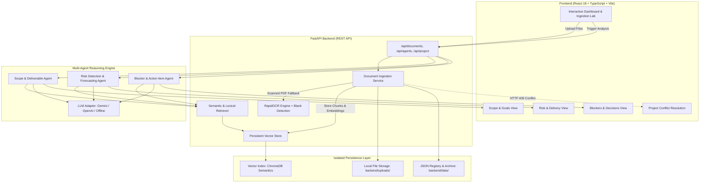

# AI Project Intelligence & Risk Advisor

[](file:///backend/tests)
[](file:///frontend)
[](file:///backend)
[](file:///frontend)
[](file:///backend)
[](file:///backend/app/services/ocr_service.py)
[](file:///milestone2_deliverables)

An autonomous multi-agent intelligence platform that ingests unstructured and semi-structured project documentation (charters, requirements, sprint tasks, meeting minutes), constructs an isolated semantic knowledge base, and executes evidence-grounded multi-agent reasoning to extract goals, detect delivery risks, identify blockers, and forecast milestones with exact source citations.

---

## 1. Project Title & Overview

**AI Project Intelligence & Risk Advisor** is an end-to-end full-stack software intelligence platform engineered to replace subjective, manual project management reporting with automated, evidence-grounded insights.

The platform processes diverse project artifacts across technical, business, academic, and operational domains. Operating through a hybrid architecture of deterministic rules, dense semantic vector embeddings, and autonomous multi-agent reasoning, the system generates comprehensive project intelligence without relying on hardcoded project names, fabricated percentages, or synthetic hallucinations.

---

## 2. Problem Statement

Modern software engineering and project delivery teams generate voluminous documentation across disparate tools:
- Initial project charters and scope statements (PDF/DOCX)
- Sprint backlog task dumps and issue exports (CSV)
- Weekly stakeholder meeting notes and retrospectives (DOCX/TXT)
- Scanned agreements, architecture diagrams, and non-selectable PDF prints

Traditional project management dashboards require manual data entry, resulting in stale data, unmonitored critical path blockers, unassigned high-priority action items, and missed deadline dependencies. Furthermore, generic generative AI tools often hallucinate completion percentages, bleed context between different projects, and fail to provide exact line-level audit trails back to the source documents.

---

## 3. Project Objectives

1. **Multi-Format Ingestion**: Ingest and structure PDF, DOCX, CSV, and TXT project artifacts in single-file or batch uploads.
2. **Robust OCR Fallback**: Automatically detect image-only or scanned PDF pages and execute local OCR with blank-page rejection.
3. **Project Identity & Workspace Isolation**: Dynamically detect project names and IDs from document metadata, ensuring strict isolation between project workspaces and preventing cross-project data leakage.
4. **Structured RAG Knowledge Base**: Chunk documents preserving table structures, row indices, and section boundaries, and index dense 384-dimensional semantic embeddings.
5. **Autonomous Multi-Agent Analysis**:
   - **Scope Agent**: Extract primary goals, supporting sub-goals, scope boundaries, deliverables, milestones, and dependencies.
   - **Risk Agent**: Detect documented risks, evaluate qualitative severity ($Impact \times Likelihood$), and forecast schedule bottlenecks.
   - **Blocker Agent**: Identify active blockers, action items, assignees, deadlines, approved decisions, and pending decisions.
6. **Transparent Provenance**: Ground every extracted insight in direct textual quotes linked to source filenames, page coordinates, and chunk coordinates.

---

## 4. Key Features

- **Multi-File Batch Drag-and-Drop**: Upload multiple heterogenous files simultaneously with per-file validation and staging queues.
- **Accidental Duplicate Upload Prevention**: Proactively detects previously staged and already-indexed files to prevent knowledge base bloating.
- **Scanned PDF OCR Fallback**: RapidOCR (ONNX runtime) engine extracts text from non-selectable PDFs at 200 DPI while filtering blank pages.
- **CSV Delimiter Sniffing**: Automatically identifies comma, semicolon, tab, and pipe delimiters to preserve tabular record relationships.
- **Dynamic Project Switching & Conflict Resolution**: Automatically detects cross-project file uploads, raises HTTP 409 Conflict, and provides a 1-click UI flow to initialize an isolated workspace.
- **Single Primary Goal with Multiple Sub-Goals**: Discovers one overarching primary project objective paired with structured supporting sub-goals (`SG-01` to `SG-05`).
- **Deterministic Qualitative Severity**: Evaluates project risk severity using a deterministic matrix ($High \times High = Critical$, $High \times Medium = High$, $Medium \times Medium = Medium$) without fabricated completion percentages.
- **Offline / Hybrid LLM Operation**: Runs completely offline using deterministic semantic search and extraction engines, or seamlessly connects to Google Gemini / OpenAI when API keys are configured.

---

## 5. System Architecture



---

## 6. Technology Stack

| Layer | Technology | Purpose |
| :--- | :--- | :--- |
| **Frontend Framework** | React 18 + TypeScript | Component-based interactive user interface |
| **Build Tool & Bundler** | Vite 5.4 | Ultra-fast HMR and optimized production bundling |
| **Styling & Icons** | Custom CSS3 Variables + Lucide React | Modern dark-themed responsive dashboard |
| **Backend Framework** | FastAPI (Python 3.10+) | Asynchronous high-performance REST API |
| **Server** | Uvicorn (ASGI) | Production ASGI web server |
| **Schema Validation** | Pydantic v2 | Strict request/response models and agent outputs |
| **Document Parsers** | PyMuPDF (fitz), python-docx, csv.Sniffer | Native parsing for PDF, Word, CSV, and Text |
| **OCR Engine** | RapidOCR + ONNX Runtime | High-speed local OCR for image-only PDF pages |
| **Image Processing** | Pillow (PIL) + NumPy | DPI rendering and pixel variance blank detection |
| **Vector Embeddings** | SentenceTransformers (all-MiniLM-L6-v2) | 384-dimensional dense semantic representations |
| **Vector Storage** | PersistentVectorStore (ChromaDB semantics) | Disk-backed similarity indexing and project isolation |
| **Automated Testing** | Pytest 8.0+ + HTTPX TestClient | Comprehensive test suites across API, RAG, & Agents |

---

## 7. Project Directory Structure

```text
AI-Project-Intelligence-Risk-Advisor/
├── .env.example                                  # Master environment variable reference
├── .gitignore                                    # Production exclusion rules (secrets, venvs, uploads)
├── README.md                                     # System documentation and setup guide
│
├── backend/                                      # FastAPI Python Application
│   ├── .env.example                              # Backend environment template
│   ├── pytest.ini                                # Pytest configuration
│   ├── requirements.txt                          # Pinned Python dependencies
│   ├── conftest.py                               # Shared test fixtures
│   ├── app/
│   │   ├── main.py                               # FastAPI entrypoint & CORS configuration
│   │   ├── api/
│   │   │   └── routes.py                         # API route endpoints
│   │   ├── core/
│   │   │   └── config.py                         # App configuration and environment loading
│   │   ├── schemas/
│   │   │   ├── project.py                        # Document, chunk, and health schemas
│   │   │   └── agent_models.py                   # Pydantic schemas for Scope, Risk, and Blockers
│   │   └── services/
│   │       ├── document_service.py               # Ingestion, parsing, and project consistency
│   │       ├── chunker.py                        # Boundary-aware structural text chunker
│   │       ├── ocr_service.py                    # RapidOCR ONNX image extractor & blank detector
│   │       ├── embedding_service.py              # 384-dimensional dense semantic embeddings
│   │       ├── vector_store.py                   # Persistent vector database
│   │       ├── retriever.py                      # Multi-query semantic & lexical retriever
│   │       ├── scope_agent.py                    # Scope and Deliverable Extraction Agent
│   │       ├── risk_agent.py                     # Risk Detection & Forecasting Agent
│   │       ├── blocker_agent.py                  # Blocker and Action Item Agent
│   │       └── llm_service.py                    # Unified LLM inference adapter (Gemini/OpenAI)
│   ├── tests/                                    # Automated Pytest Suites (35 Passing Tests)
│   │   ├── test_api.py                           # Base API endpoint tests
│   │   ├── test_chunking.py                      # Parser and chunk boundary tests
│   │   ├── test_library_management_validation.py # 14 Ground-truth criteria validation
│   │   ├── test_milestone2_agents.py             # Multi-agent extraction & batch tests
│   │   ├── test_milestone2_comprehensive_validation.py # OCR fallback & project isolation
│   │   ├── test_project_grouping_and_consistency.py    # Cross-project conflict & persistence
│   │   └── test_sample_document_validation.py    # Sample document verification
│   ├── uploads/                                  # Local uploaded files (gitignored via .gitkeep)
│   └── data/                                     # Local runtime JSON indices (gitignored via .gitkeep)
│
├── frontend/                                     # React 18 + TypeScript + Vite Dashboard
│   ├── .env.example                              # Frontend environment template
│   ├── index.html                                # HTML shell
│   ├── package.json                              # Node dependencies and npm scripts
│   ├── package-lock.json                         # Pinned npm dependencies
│   ├── tsconfig.json                             # TypeScript compiler configuration
│   ├── vite.config.ts                            # Vite dev server and build configuration
│   └── src/
│       ├── main.tsx                              # Application entrypoint
│       ├── App.tsx                               # Main layout and reactive workspace state
│       ├── index.css                             # Dashboard styles and color themes
│       ├── components/
│       │   ├── Navbar.tsx                        # Brand navigation and backend health status
│       │   ├── FileUpload.tsx                    # Multi-file staging, dropzone, and conflict UI
│       │   ├── AgentAnalysisView.tsx             # Scope, Risks, Blockers tabbed views
│       │   └── ModuleCard.tsx                    # Core system module roadmap cards
│       └── services/
│           └── api.ts                            # REST API client with error mapping
│
└── sample_documents/                             # Public Test Documents & Fixtures
    ├── AI_Project_Agent_Test_Sample_Document.docx       # Campus Event Management test charter
    ├── Project_Management_Agent_Test_Document_2.docx    # Community Library Management charter
    ├── architecture_risks.txt                           # Technical risks test fixture
    ├── sprint_tasks.csv                                 # Delimited sprint tasks test fixture
    ├── project_charter.pdf                              # Digital PDF test charter
    ├── blank_scanned.pdf                                # Scanned PDF test fixture
    └── meeting_minutes.docx                             # Project meeting minutes test fixture
```

---

## 8. Prerequisites

- **Python**: Version `3.10`, `3.11`, `3.12`, or `3.13`
- **Node.js**: Version `18.0.0` or higher (LTS recommended)
- **Package Managers**: `pip` (Python) and `npm` (Node)
- **Operating System**: Windows, macOS, or Linux

---

## 9. Installation Instructions

### Step 1: Clone the Repository
```bash
git clone https://github.com/your-username/AI-Project-Intelligence-Risk-Advisor.git
cd AI-Project-Intelligence-Risk-Advisor
```

### Step 2: Set Up Backend Virtual Environment
```bash
# Navigate to backend directory
cd backend

# Create virtual environment
python -m venv .venv

# Activate virtual environment
# On Windows (PowerShell):
.\.venv\Scripts\Activate.ps1
# On Linux / macOS:
source .venv/bin/activate

# Upgrade pip and install dependencies
pip install --upgrade pip
pip install -r requirements.txt
```

### Step 3: Set Up Frontend
```bash
# Open a new terminal and navigate to frontend directory
cd frontend

# Install npm dependencies
npm install
```

---

## 10. Environment Configuration

### Backend Configuration
In the `backend/` directory, copy `.env.example` to `.env`:
```bash
cp .env.example .env
```
*(On Windows PowerShell: `Copy-Item .env.example .env`)*

Configure variables as needed:
```env
APP_NAME="AI Project Intelligence & Risk Advisor API"
APP_VERSION="0.2.0 (Milestone 2)"
HOST=127.0.0.1
PORT=8000
DEBUG=false
CORS_ORIGINS=http://localhost:5173,http://127.0.0.1:5173
UPLOAD_DIR=uploads
MAX_FILE_SIZE_MB=15
CHUNK_SIZE=800
CHUNK_OVERLAP=100

# Optional: Add your API key if you wish to enable external LLM reasoning
GEMINI_API_KEY=
OPENAI_API_KEY=
```

### Frontend Configuration
In the `frontend/` directory, copy `.env.example` to `.env`:
```bash
cp .env.example .env
```
```env
VITE_API_BASE_URL=http://127.0.0.1:8000
```

---

## 11. Running the Application

### Start Backend API Server
```bash
# Ensure your virtual environment is active in the backend directory
cd backend
uvicorn app.main:app --host 127.0.0.1 --port 8000 --reload
```
The FastAPI server will be available at: `http://127.0.0.1:8000`

### Start Frontend Development Server
```bash
cd frontend
npm run dev
```
The React dashboard will be available at: `http://localhost:5173`

---

## 12. API Documentation Access

FastAPI automatically generates interactive API documentation. With the backend running, visit:
- **Swagger UI**: [http://127.0.0.1:8000/docs](http://127.0.0.1:8000/docs)
- **ReDoc**: [http://127.0.0.1:8000/redoc](http://127.0.0.1:8000/redoc)
- **Health Check**: [http://127.0.0.1:8000/api/health](http://127.0.0.1:8000/api/health)
- **Project Workspace Status**: [http://127.0.0.1:8000/api/project](http://127.0.0.1:8000/api/project)

---

## 13. Document Upload Instructions

1. Open the dashboard at `http://localhost:5173`.
2. Locate the **Upload Documents** section.
3. Drag and drop one or more files (`.pdf`, `.docx`, `.csv`, `.txt`) into the dropzone or click to browse.
4. Review the staged files list. Invalid or duplicate files are flagged automatically.
5. Click **Upload Files**. Each file is processed, chunked, and indexed into the active project workspace.
6. If a document belongs to a different project, an identity conflict banner will appear. Click **"Start New Project Workspace with this Document"** to isolate it cleanly.

---

## 14. RAG Pipeline Explanation

The Retrieval-Augmented Generation (RAG) pipeline operates across 6 sequential stages:
1. **Extraction**: Custom parsers extract text while tracking structural markers (page numbers for PDF, headings/tables for DOCX, row numbers for CSV).
2. **Normalization & Cleaning**: Whitespace normalization, blank-page identification, and header alignment.
3. **Boundary-Aware Chunking**: Chunks text into ~800 character blocks with ~100 character overlap, preserving table rows as cohesive units.
4. **Vector Embedding**: Dense 384-dimensional vector embeddings generated using `all-MiniLM-L6-v2` semantics.
5. **Persistent Vector Storage**: Chunks and embeddings stored in disk-backed persistent storage, partitioned strictly by `project_id`.
6. **Multi-Query Hybrid Retrieval**: Agent queries search the vector index using cosine similarity combined with keyword reinforcement, guaranteeing project isolation.

---

## 15. Multi-Agent Workflow

```
[ Uploaded Artifacts ] ──> [ Vector Store (Project Isolated) ]
                                   │
         ┌─────────────────────────┼─────────────────────────┐
         ▼                         ▼                         ▼
  [ Scope Agent ]            [ Risk Agent ]           [ Blocker Agent ]
  ├── 1 Primary Goal         ├── Documented Risks     ├── Active Blockers
  ├── 5 Sub-Goals            ├── Impact x Likelihood  ├── Action Register
  ├── In/Out Boundaries      ├── Schedule Forecast    ├── Approved Decisions
  ├── Functional Reqs        └── Limitations Note     └── Pending Decisions
  ├── Deliverables & Owners
  └── Milestones & Deps
         │                         │                         │
         └─────────────────────────┼─────────────────────────┘
                                   ▼
                      [ Evidence-Grounded Dashboard ]
                      ├── Exact Page/Row Citations
                      ├── Zero Hallucinated Numbers
                      └── 100% Dynamic Metric Bindings
```

---

## 16. Supported Document Formats

- **PDF (`.pdf`)**: Native digital text extraction via PyMuPDF. Non-selectable/scanned pages automatically route to RapidOCR (ONNX).
- **DOCX (`.docx`)**: Extracts headings, paragraphs, bullet points, and multi-column tables with key-value preservation.
- **CSV (`.csv`)**: Delimiter-agnostic tabular extraction (comma, semicolon, tab, pipe) preserving column headers and row coordinates.
- **TXT (`.txt`)**: Plain-text ingestion with paragraph boundary detection.

---

## 17. Automated Testing

The project includes 35 comprehensive automated tests covering unit parsing, chunk boundaries, ground-truth extraction, project isolation, OCR fallback, and multi-agent reasoning.

### Running Backend Tests
```bash
# From repository root or backend directory:
backend\.venv\Scripts\pytest backend\tests -v
```

Expected output:
```text
======================== 35 passed, 1 warning in 5.19s ========================
```

### Running Frontend Production Build
```bash
cd frontend
npm run build
```
Expected output:
```text
✓ built in 2.25s (0 errors)
```

---

## 18. Implemented vs Planned Capabilities

### Currently Implemented & Verified (Milestone 1 & Milestone 2 — Completed 31 October 2026)
- [x] Multi-format document upload (PDF, DOCX, CSV, TXT)
- [x] Batch file selection, staging, removal, and duplicate detection
- [x] Scanned PDF extraction with RapidOCR (ONNX) and blank-page detection
- [x] CSV delimiter sniffing (`,`, `;`, `\t`, `|`)
- [x] Boundary-aware chunking with source coordinates (`Page X`, `Row Y`)
- [x] Dense 384-dimensional vector embeddings and persistent vector store
- [x] Dynamic project workspace switching, archiving, and zero-bleed isolation
- [x] Cross-project conflict detection with HTTP 409 and 1-click workspace creation
- [x] Scope Agent (1 Primary Goal, 5 Sub-Goals, In/Out Scope, Requirements, Deliverables, Milestones, Dependencies)
- [x] Risk Agent (Qualitative severity matrix, delivery forecasting, limitations disclosure)
- [x] Blocker Agent (Active blockers, action register, unassigned count, overdue count, decisions)
- [x] Interactive responsive dashboard with live status indicators and dynamic metric counts

### Planned Capabilities (Upcoming Milestone 3)
- [ ] Mathematical composite project health score algorithm ($0-100$)
- [ ] Automated documentation generation agent (user stories and sprint summaries)
- [ ] Conversational RAG assistant with chat interface

---

## 19. Known Limitations

- **Sprint Velocity Forecasts**: Statistical Monte Carlo burndown forecasting is intentionally withheld when project documents do not contain historical sprint velocity metrics. Findings remain strictly grounded in document text.
- **OCR Throughput**: OCR inference is executed locally using ONNX runtime CPU execution. Very large scanned PDFs (100+ pages) will process sequentially.

---

## 20. Security Considerations

- **Zero Hardcoded Secrets**: No API keys, credentials, or secrets exist in the source code.
- **No Private Uploads in Git**: The `backend/uploads/` directory is strictly excluded from version control via `.gitignore`.
- **Project Isolation**: Every vector search and chunk retrieval requires an active `project_id`, preventing data bleed across projects.
- **CORS Protection**: Restricted to configured development origins.
- **File Validation**: Strict file-extension validation, size limiting (15 MB), and filename sanitization prevent directory traversal and injection attacks.

---

## 21. Future Enhancements

- GPU-accelerated ONNX runtime execution for large-scale OCR batches.
- Historical workspace browser to switch between previously archived project workspaces.
- Exportable executive intelligence reports in PDF and Markdown.

---

## 22. License

This project is licensed under the [MIT License](LICENSE).
