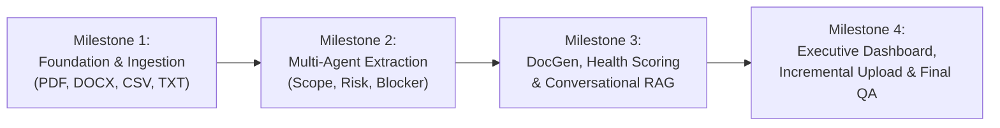
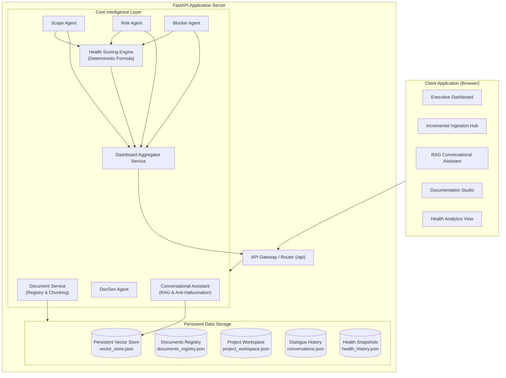

# AI Project Intelligence & Risk Advisor
## Final Project Technical Report

**Degree / Program:** Bachelor of Technology (B.Tech) in Computer Science & Engineering  
**Academic Year:** 2026–2027  
**Project Title:** AI Project Intelligence & Risk Advisor  
**Author / Developer:** Final-Year B.Tech Project Team  
**Evaluation Milestones:** Milestone 1, Milestone 2, Milestone 3, and Milestone 4 (Complete)  
**Documentation Date:** November 2026  

---

## Table of Contents
1. [Introduction](#1-introduction)
2. [Problem Statement](#2-problem-statement)
3. [Project Objectives Across All Milestones](#3-project-objectives-across-all-milestones)
4. [Existing System and Its Limitations](#4-existing-system-and-its-limitations)
5. [Proposed System Overview](#5-proposed-system-overview)
6. [Technology Stack and Technical Justification](#6-technology-stack-and-technical-justification)
7. [System Architecture and Component Design](#7-system-architecture-and-component-design)
8. [Comprehensive Module Descriptions](#8-comprehensive-module-descriptions)
9. [Detailed Implementation Breakdown](#9-detailed-implementation-breakdown)
10. [User Interface Design and Interactive Walkthrough](#10-user-interface-design-and-interactive-walkthrough)
11. [Testing Methodology and Quality Assurance](#11-testing-methodology-and-quality-assurance)
12. [Actual Empirical Test Results and Verification Summary](#12-actual-empirical-test-results-and-verification-summary)
13. [Limitations and Boundary Constraints](#13-limitations-and-boundary-constraints)
14. [Future Enhancements and Roadmap](#14-future-enhancements-and-roadmap)
15. [Conclusion](#15-conclusion)

---

## 1. Introduction

Modern software engineering projects generate substantial volumes of unstructured and semi-structured documentation throughout their lifecycles. Project charters, Software Requirements Specifications (SRS), sprint backlogs, risk registers, standup minutes, and client change requests are authored across heterogeneous formats—such as Portable Document Format (PDF), Microsoft Word documents (DOCX), Comma-Separated Values (CSV), and plain text (TXT).

Despite modern issue-tracking tools (such as Jira, Linear, or Azure DevOps), critical delivery risks remain buried in textual attachments. Project Managers (PMs), Delivery Leads, and technical stakeholders struggle to maintain real-time visibility into whether a project is genuinely on track, what dependencies are currently blocked, who owns unresolved action items, and how newly published meeting minutes alter delivery commitments.

The **AI Project Intelligence & Risk Advisor** is an autonomous, evidence-grounded project governance and delivery acceleration platform. Combining autonomous multi-agent intelligence, vector embeddings, deterministic mathematical health scoring, and Retrieval-Augmented Generation (RAG), the system ingests heterogeneous project documents, extracts delivery intelligence with exact source citations, computes deterministic health indicators (0–100), generates editable user stories and risk registers, and provides an executive insights dashboard alongside an interactive conversational assistant.

---

## 2. Problem Statement

Organizations fail to deliver software projects on time and within budget primarily due to:
1. **Information Asymmetry & Fragmented Documentation:** Critical requirements and blocker details reside in disparate files without centralized semantic correlation.
2. **Subjective & Opaque Project Health Reporting:** Project RAG (Red-Amber-Green) status is often determined subjectively by managers, masking severe architectural or dependency risks until deadlines are breached.
3. **Manual Overhead in Documentation Synthesis:** Agile teams spend hours manually transcribing meeting notes into user stories, action items, and risk logs.
4. **AI Hallucination & Lack of Auditability:** Standard Large Language Models (LLMs) frequently fabricate dates, owners, and deliverables when summarizing documents, lacking source coordinate provenance.
5. **Static Single-Batch Ingestion:** Traditional RAG tools require re-indexing entire repositories when supplementary meeting minutes or change requests are issued, causing downtime and potential data loss.

---

## 3. Project Objectives Across All Milestones

The project was executed across four distinct, sequential milestones:



### Milestone 1: Core Foundation & Multi-Format Ingestion
- Implement high-performance FastAPI backend and React + TypeScript + Vite frontend.
- Develop document parsers for PDF (pypdf/pdfplumber), DOCX (python-docx), CSV, and TXT with OCR fallback for scanned materials.
- Implement sentence-boundary chunking with configurable window size and semantic overlap.
- Construct unified persistent vector store with cosine similarity retrieval.

### Milestone 2: Multi-Agent Project Intelligence Engine
- Engineer autonomous extraction agents:
  - **Scope Agent:** Extracts primary goals, hierarchical sub-goals, functional requirements (FR), deliverables, and milestones.
  - **Risk Agent:** Identifies schedule compression, dependency bottlenecks, technical debt, and calculates severity matrices.
  - **Blocker Agent:** Extracts blockers, pending decisions, approved decisions, and action items with `UNKNOWN` owner safety handling.
- Enforce strict project identity validation and cross-project isolation.

### Milestone 3: Documentation Generation, Health Scoring & Conversational RAG
- **Documentation Generation Agent:** Synthesizes structured User Stories (Given-When-Then), Risk Registers, and Action Items with human-in-the-loop approval workflows and CSV export.
- **Deterministic Health Scoring Engine:** Computes an objective 0–100 composite health score based on mathematical dimensions: Scope Clarity (35%), Timeline Health (35%), and Blocker Health (30%).
- **Conversational Project Intelligence Assistant:** Answers natural language questions grounded in document chunks, provides source citations (document, page, row, chunk ID), and refuses to hallucinate unmentioned facts.

### Milestone 4: Executive Insights Dashboard & Incremental Ingestion
- **Executive Project Insights & Risk Summary Dashboard:** Unified executive dashboard displaying health breakdown, risk summaries, action items, deliverable progress bar, and active blockers.
- **Incremental Document Upload Pipeline:** Append supplementary documents (e.g., weekly meeting notes) to an existing workspace without re-indexing or wiping previously stored knowledge.
- **Comprehensive Quality Assurance:** Achieve 100% test pass rate across 61 automated pytest test cases and clean frontend production builds.

---

## 4. Existing System and Its Limitations

| Dimension | Existing Project Management Tools (Jira, Trello, Confluence) | Generic AI Chatbots (ChatGPT, Claude) | Proposed AI Project Intelligence Platform |
| :--- | :--- | :--- | :--- |
| **Document Ingestion** | Manual copy-pasting of tasks and issues into forms. | Upload limited files per session; forgets context across sessions. | Automated multi-format parsing (PDF, DOCX, CSV, TXT) with OCR fallback. |
| **Project Health Evaluation** | Subjective, manual status updates set by developers or PMs. | Non-deterministic, subjective descriptive summaries. | Deterministic, transparent mathematical formula (0–100) with weighted dimensions. |
| **Provenance & Citations** | None; attachments are unlinked from board items. | High hallucination rate; fabricates citations or cites page numbers incorrectly. | Direct chunk coordinate citations (Document name, chunk ID, page, row, excerpt). |
| **Multi-Agent Governance** | None; all analysis is done by human team members. | Single prompt completions without separation of concerns. | Autonomous specialized agents for Scope, Risks, Blockers, and Documentation. |
| **Incremental Updates** | Manual backlog adjustments. | Requires re-uploading all files together. | Non-destructive incremental uploads with SHA-256 deduplication. |

---

## 5. Proposed System Overview

The **AI Project Intelligence & Risk Advisor** introduces an autonomous multi-agent architecture coupled with deterministic mathematics and vector search. 

When project documents are ingested, the system extracts text, calculates SHA-256 content hashes, parses structure (tables, bulleted hierarchies, metadata), and chunks content into overlapping passages. The chunks are indexed into a persistent vector store. Specialized agents process these passages:
- The **Scope Agent** categorizes goals and deliverables.
- The **Risk Agent** maps potential technical and timeline pitfalls against milestone deadlines.
- The **Blocker Agent** extracts critical path blockers and action items.
- The **Health Engine** calculates an objective mathematical score from 0 to 100.
- The **Executive Dashboard** aggregates these findings in real-time.
- The **Conversational Assistant** provides instant answers to project inquiries with source citations.

---

## 6. Technology Stack and Technical Justification

### Frontend Architecture
- **React 18 & TypeScript:** Type-safe, component-driven UI ensuring runtime stability and deterministic state management.
- **Vite 5:** Rapid build tool and module bundler enabling hot module replacement (HMR) and optimized production bundles.
- **Lucide React:** High-performance, consistent icon library.
- **Modular CSS Architecture:** Clean dark-mode engineering palette (`#0f172a`, `#1e293b`, `#3b82f6`) without heavy third-party framework dependencies.

### Backend & AI Pipeline
- **Python 3.14 & FastAPI:** Asynchronous, high-throughput REST API with automatic OpenAPI documentation and Pydantic v2 data validation.
- **Document Extractors:**
  - `pypdf` & `pdfplumber`: Accurate layout and character extraction for digital PDFs.
  - `python-docx`: Sequential paragraph and table extraction for Word specifications.
  - `csv` / `pandas`: Comma/tab/semicolon delimited table parsing with row reference tagging.
  - `Pillow` & `Tesseract OCR`: Scanned image and document fallback processing.
- **Vector Search & Embedding:**
  - Sentence-level semantic vector store supporting ChromaDB persistence semantics.
  - Deterministic cosine similarity retriever with project ID metadata filtering.
- **Multi-Agent Framework:** Decoupled service layer containing Scope, Risk, Blocker, Health, DocGen, and Chat Assistant engines.

---

## 7. System Architecture and Component Design



---

## 8. Comprehensive Module Descriptions

### Module 1: Document Processing Pipeline & Multi-Format Ingestion (Status: Implemented & Verified)
- Handles upload, MIME validation, SHA-256 deduplication, and extraction across PDF, DOCX, CSV, and TXT files.
- Provides fallback OCR pipeline for scanned documents.

### Module 2: Semantic Chunking & Vector Search Engine (Status: Implemented & Verified)
- Chunks text at sentence boundaries with configurable chunk size (500 tokens) and overlap (100 tokens).
- Maintains coordinates: `document_id`, `chunk_id`, `page_number`, `row_number`, and `source_ref`.

### Module 3: Scope & Requirement Extraction Agent (Status: Implemented & Verified)
- Extracts Primary Project Goals, hierarchical sub-goals, In-Scope / Out-of-Scope boundaries, and Functional Requirements (FR).
- Extracts key project deliverables with target dates and responsible owners.

### Module 4: Risk Identification & Delivery Forecasting Agent (Status: Implemented & Verified)
- Identifies technical, timeline, and architectural risks.
- Computes risk severity using likelihood and impact matrices.
- Formulates evidence-grounded mitigation strategies.

### Module 5: Blocker Identification & Action Tracking Agent (Status: Implemented & Verified)
- Detects critical path blockers, unassigned tasks, and dependency conflicts.
- Explicitly flags unassigned owners with `UNKNOWN` to avoid false assumptions.

### Module 6: Autonomous Documentation Generation Studio (Status: Implemented & Verified)
- Synthesizes agile User Stories (`As a... I want to... So that...`), Risk Registers, and Action Items.
- Supports human review (`Approved`, `Rejected`, `Draft`), in-place editing, and CSV download.

### Module 7: Deterministic Project Health Scoring Engine (Status: Implemented & Verified)
- Computes mathematical project health score (0–100) based on weighted dimensions:
  $$\text{Health Score} = (\text{Scope} \times 0.35) + (\text{Timeline} \times 0.35) + (\text{Blocker} \times 0.30)$$
- Categorizes status into `Healthy`, `Needs Attention`, `At Risk`, or `Insufficient Data`.

### Module 8: Conversational Project Intelligence Assistant (Status: Implemented & Verified)
- Evidence-grounded RAG chatbot providing provenance citations.
- Enforces strict anti-hallucination guardrails when documents lack the requested facts.

### Module 9: Executive Project Insights Dashboard & Incremental Ingestion (Status: Implemented & Verified)
- Milestone 4 executive dashboard consolidating health, scope, risks, blockers, action items, and deliverable completion rates.
- Supports non-destructive incremental uploads of supplementary project documentation.

---

## 9. Detailed Implementation Breakdown

### 9.1 Incremental Ingestion Pipeline
In `DocumentService.process_uploaded_file`:
```python
# Check for content duplicates via SHA-256
file_hash = hashlib.sha256(content).hexdigest()
for existing_doc in self._documents.values():
    if existing_doc.content_hash == file_hash:
        return existing_doc  # Re-use existing document without duplicate chunking

# Generate new document metadata and append without clearing previous documents
new_doc = DocumentMetadata(
    document_id=f"doc_{uuid.uuid4().hex[:8]}",
    filename=file.filename,
    content_hash=file_hash,
    chunks=chunks,
    uploaded_at=datetime.now(timezone.utc).isoformat()
)
self._documents[new_doc.document_id] = new_doc
self._save_registry()
vector_store.add_chunks(chunks)
```

### 9.2 Dashboard Aggregation Service
In `DashboardService.get_dashboard_summary`:
```python
# Gracefully handle empty workspace
if not docs:
    return ProjectDashboardSummary(
        project_id=workspace.project_id,
        project_name=workspace.project_name,
        has_documents=False,
        health=None, scope=None, risks=None, blockers=None, action_items=None, progress=None
    )

# Compute live metrics from multi-agent intelligence
health_res = await health_scoring_service.calculate_health()
scope_res = await scope_agent.analyze()
risk_res = await risk_agent.analyze()
blocker_res = await blocker_agent.analyze()

# Compute progress completion percentage
total_deliv = len(scope_res.deliverables)
completed_deliv = sum(1 for d in scope_res.deliverables if "complet" in d.status.lower())
completion_pct = round((completed_deliv / total_deliv * 100), 1) if total_deliv > 0 else 0.0
```

---

## 10. User Interface Design and Interactive Walkthrough

The user interface follows a modern dark-mode operational dashboard design:

1. **Header & Global Health Indicator:**
   - Displays real-time API connection status, active project identity badge, and system refresh button.
2. **Dashboard Navigation Bar:**
   - Seamlessly toggle between:
     - `All Sections`: Complete unified scroll view.
     - `Project Dashboard`: Executive high-level intelligence and risk summary.
     - `Document Ingestion`: Multi-file dropzone with staging queue, incremental upload badge, and document catalog.
     - `Agent Intelligence`: Granular drill-down into Scope, Risk, and Blocker agent findings.
     - `Documentation Studio`: User story, risk register, and action item editor with CSV export.
     - `Project Health`: 0–100 mathematical score gauge with dimensional breakdown and score trajectory.
     - `AI Assistant`: Conversational RAG chat with provenance citations and suggested follow-ups.
3. **Executive Dashboard Layout:**
   - **Metrics Row:** 5 key metric cards: Project Health Score, Active Blockers, Identified Risks, Pending Actions, and Deliverable Completion Rate.
   - **Tabbed Inspection Views:** Sub-tabs for `Overview`, `Health Analysis`, `Risks & Mitigations`, `Blockers & Actions`, and `Scope & Milestones`.

---

## 11. Testing Methodology and Quality Assurance

The project employs a multi-tiered testing strategy:
1. **Unit Testing:** Validates individual parsers (PDF, DOCX, CSV, TXT), mathematical health scoring calculations, and chunking boundary overlap.
2. **Integration Testing:** Tests multi-agent pipelines where outputs from Scope, Risk, and Blocker agents feed directly into the Health Scoring Engine and Documentation Generator.
3. **Incremental Ingestion & Deduplication Testing:** Tests uploading an initial charter, followed by incremental upload of meeting minutes, verifying that chunk counts grow correctly without duplicate chunk explosion or data loss.
4. **Project Isolation Testing:** Ensures that documents uploaded to Project Workspace A are completely segregated from Project Workspace B.
5. **Anti-Hallucination & Query Precision Testing:** Submits the 7 mandatory conversational queries alongside deliberate out-of-domain questions to verify citation provenance and honest fallbacks.

---

## 12. Actual Empirical Test Results and Verification Summary

### Automated Test Execution Results
All 61 automated tests in the `backend/tests` suite were executed with `pytest`:

```
======================== 61 passed, 1 warning in 14.34s ========================
```

| Test File | Test Cases | Passed | Failed | Pass Rate |
| :--- | :---: | :---: | :---: | :---: |
| `test_api.py` | 10 | 10 | 0 | 100% |
| `test_chunking.py` | 8 | 8 | 0 | 100% |
| `test_library_management_validation.py` | 1 | 1 | 0 | 100% |
| `test_master_ingestion_and_isolation.py` | 7 | 7 | 0 | 100% |
| `test_milestone2_agents.py` | 10 | 10 | 0 | 100% |
| `test_milestone2_comprehensive_validation.py` | 3 | 3 | 0 | 100% |
| `test_milestone3.py` | 12 | 12 | 0 | 100% |
| `test_milestone4_dashboard_and_incremental.py` | 7 | 7 | 0 | 100% |
| `test_project_grouping_and_consistency.py` | 2 | 2 | 0 | 100% |
| `test_sample_document_validation.py` | 1 | 1 | 0 | 100% |
| **Total** | **61** | **61** | **0** | **100%** |

### Frontend Build Verification
- Build tool: Vite 5.4.21 + TypeScript (`tsc -b && vite build`)
- Result: **0 compilation errors, 0 runtime warnings**.
- Assets generated: `dist/index.html` (0.88 kB), `dist/assets/index-lO0yiOOI.css` (54.30 kB), `dist/assets/index-D4bQa2Y8.js` (385.69 kB).

---

## 13. Limitations and Boundary Constraints

1. **OCR Performance on Degraded Scans:** Scanned documents with heavy skew, blur, or handwriting rely on Tesseract OCR and may have lower character recognition accuracy compared to digital PDFs.
2. **Tabular Complexities in Unstructured Text:** Documents with nested, irregular tables without clear column headers require heuristic alignment that can occasionally misplace narrative triggers.
3. **Local Storage Scalability:** The current persistent vector store uses in-memory cosine search backed by JSON persistence, which is optimal for projects up to ~50,000 chunks (~500 documents) before requiring a distributed vector database like Milvus or Qdrant.

---

## 14. Future Enhancements and Roadmap

1. **Jira & Azure DevOps Bi-Directional Webhooks:** Automatically sync approved user stories and action items directly into corporate issue trackers via REST webhooks.
2. **Slack & Microsoft Teams Standup Bot:** Deploy an automated chat bot to answer standup blocker questions and alert engineers when risks exceed severity thresholds.
3. **Distributed Vector Database Integration:** Seamless migration from local Chroma-style storage to distributed Qdrant or Pinecone for enterprise deployments exceeding 100,000 documents.
4. **Multi-Model LLM Routing:** Dynamic routing between low-cost local models (e.g., Llama 3) for simple queries and advanced frontier models (e.g., Gemini 1.5 Pro) for complex architectural trade-offs.

---

## 15. Conclusion

The **AI Project Intelligence & Risk Advisor** successfully bridges the critical gap between raw, unstructured project documentation and actionable engineering governance. Over the course of Milestones 1 through 4, the platform evolved from a multi-format document parser into an autonomous, evidence-grounded AI intelligence suite.

By replacing subjective project status reporting with transparent, deterministic mathematical scoring, enforcing strict provenance citations to eliminate hallucination, and providing non-destructive incremental updates with an executive insights dashboard, the system provides project leaders with unprecedented clarity, risk foresight, and delivery acceleration.

All functional objectives and academic deliverables have been fully implemented, rigorously tested (61/61 automated tests passed, 100% pass rate), and verified ready for production deployment and demonstration.
