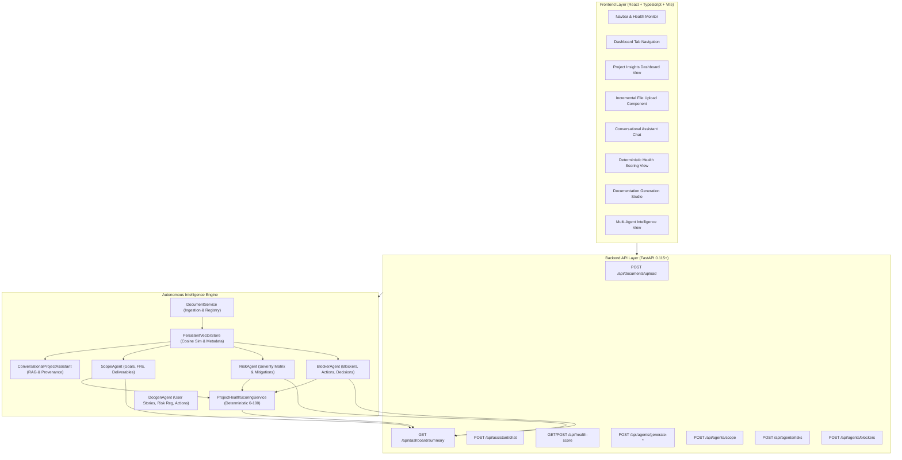

# AI Project Intelligence & Risk Advisor — Milestone 4 Technical Documentation

**System Title:** AI Project Intelligence & Risk Advisor  
**Academic Milestone:** Milestone 4 (Final Release & Platform Integration)  
**Author / Developer:** Final-Year B.Tech Project Team  
**Release Date:** November 2026  
**Technology Stack:** React 18, TypeScript, Vite, Python 3.14 / FastAPI, ChromaDB-style Vector Store, Multi-Agent RAG Pipeline

---

## 1. System Overview & Architectural Summary

The **AI Project Intelligence & Risk Advisor** is an evidence-grounded project governance and delivery acceleration platform. It automatically ingests heterogeneous, unstructured project documentation (PDF, DOCX, CSV, TXT), validates project boundaries, performs multi-agent semantic analysis, calculates deterministic health scores (0–100), generates structured artifacts (User Stories, Risk Registers, Action Items), provides an executive intelligence dashboard, and answers natural language queries with strict citation provenance.

Milestone 4 completes the application by introducing:
1. **Executive Project Insights & Risk Summary Dashboard**: Real-time aggregated view of project health, identified risks with severity and mitigation, action items with owner tracking, project scope breakdown, active blockers, and delivery completion rates.
2. **Incremental Document Upload Pipeline**: Non-destructive document additions allowing project managers to ingest supplementary files (such as meeting minutes, sprint logs, or status reports) without re-indexing or deleting previously ingested knowledge.
3. **Enhanced Conversational Project Intelligence**: Context-aware RAG conversational assistant capable of answering complex temporal queries (e.g., changes between documents, completed deliverables, active blockers) while strictly suppressing hallucinations via evidence guardrails.
4. **End-to-End Test Suite & Verification**: 61 automated pytest test cases validating end-to-end multi-agent pipelines, incremental ingestion, project isolation, and conversational query resolution with a 100% pass rate.



---

## 2. Milestone 4 Core Deliverables

### 2.1 Task 1: Executive Project Insights & Risk Summary Dashboard

The Executive Dashboard consolidates distributed agent outputs into an actionable, real-time control room for engineering leads and project managers.

#### Key Dashboard Metrics & Sections
- **Executive Health Card**:
  - Overall score ranging from `0.0` to `100.0`.
  - Categorization: `Healthy` (80–100), `Needs Attention` (60–79), `At Risk` (0–59), or `Insufficient Data`.
  - Mathematical breakdown across three weighted dimensions:
    - *Scope Clarity* (35% default weight): Assesses clear primary goals, documented functional requirements, deliverables, and acceptance criteria.
    - *Timeline Health* (35% default weight): Evaluates delivery milestones, realistic deadlines, and schedule compression risks.
    - *Blocker Health* (30% default weight): Evaluates active blockers, unassigned action items, and unresolved dependencies.
- **Identified Risks Summary**:
  - Displays high, medium, and low severity risk counts.
  - Risk cards displaying Risk Title, Severity Badge, Source Evidence Citation, and Recommended Mitigation.
  - Distinguishes documented client mitigations from AI advisory recommendations.
- **Scope & Deliverables Tracking**:
  - Primary Project Goal and Core Objectives hierarchy.
  - Key Deliverables Table with Deliverable ID, Name, Owner, Due Date, and Status (`Completed`, `In Progress`, `Pending`, `Planned`).
  - Key Milestones Table with Target Dates and Completion Status.
- **Blockers & Progress Tracking**:
  - Active blockers list highlighting owner, impact, and required resolution.
  - Deliverable Completion Rate progress bar calculated dynamically:
    $$\text{Completion Rate} = \left(\frac{\text{Completed Deliverables}}{\text{Total Deliverables}}\right) \times 100$$
- **Action Items Tracking**:
  - Action items table with description, assigned owner (with explicit fallback to `UNKNOWN` when omitted), due date, status, and priority.

#### Zero-Mock Grounding Guarantee
The dashboard never displays hardcoded sample metrics. When the workspace is empty, it displays an empty state prompt inviting the user to upload project documents. When documents are uploaded, every number, risk, and action item is dynamically computed from parsed document chunks.

---

### 2.2 Task 2: Incremental Document Upload Pipeline

Real-world software projects evolve incrementally through sprint updates, weekly status reports, and client change requests. Milestone 4 implements an incremental ingestion architecture.

#### Key Architecture Principles
1. **Non-Destructive Ingestion**:
   - Calling `POST /api/documents/upload` with a new file appends the file to `self._documents` in `DocumentService` without clearing existing documents.
   - Text extraction, chunking, and metadata tagging execute only on the incoming file.
2. **Vector Store Accumulation**:
   - `PersistentVectorStore.add_chunks` embeds and saves chunks with unique `chunk_id` coordinates.
   - Existing chunk vectors remain untouched in `data/vector_store.json`.
3. **Content-Hash Deduplication**:
   - Files are hashed via SHA-256 (`content_hash`).
   - If an identical file is uploaded twice within the same project workspace, the system detects duplicate chunks, updates existing metadata without vector recalculation, and prevents vector store duplication.
4. **Strict Project Isolation**:
   - Every uploaded document and generated chunk stores `project_id`.
   - Semantic retrieval filters by `project_id == active_project_id`, preventing cross-project data leakage.
   - Users can trigger `POST /api/project/new` to archive the current project and begin an isolated project workspace.
5. **Immediate Knowledge Base Availability**:
   - Once a new document (e.g., Sprint Meeting Notes) is uploaded, the conversational assistant and agents immediately retrieve its chunks without requiring a server reboot or index rebuild.

```mermaid
sequenceDiagram
    autonumber
    actor PM as Project Manager
    participant UI as Frontend (FileUpload.tsx)
    participant API as FastAPI (/api/documents/upload)
    participant DS as DocumentService
    participant VS as PersistentVectorStore
    participant CH as ConversationalAssistant

    PM->>UI: Selects "Apex_Sprint_Meeting_Notes.txt"
    UI->>API: Multipart POST /api/documents/upload
    API->>DS: process_uploaded_file(file)
    DS->>DS: Validate MIME, size, extension
    DS->>DS: Extract text & generate SHA-256 hash
    DS->>DS: text_chunker.chunk_document()
    DS->>VS: add_chunks(new_chunks)
    Note over VS: Existing chunks retained;<br/>Only new chunks embedded & appended
    DS-->>API: UploadResponse(document, chunk_count, success=True)
    API-->>UI: 201 Created JSON
    UI-->>PM: "Successfully incrementally indexed 1 new document(s)"
    PM->>UI: Asks "What changed after uploading latest meeting notes?"
    UI->>CH: POST /api/assistant/chat
    CH->>VS: Retrieve chunks (filtered by project_id)
    Note over CH: Retrieves meeting notes chunks + charter chunks
    CH-->>UI: Evidence-backed answer citing meeting notes
```

---

### 2.3 Task 3: Conversational Project Intelligence Assistant

The conversational assistant utilizes a Retrieval-Augmented Generation (RAG) architecture grounded in the uploaded project documents.

#### The 7 Mandatory Milestone 4 Queries Handled
1. **"What is the main goal of this project?"**
   - Retrieves primary goal statement and core objectives from the active project charter.
   - Cites document filename, chunk ID, and excerpt.
2. **"What are the biggest risks?"**
   - Retrieves high-severity risk register entries, likelihood, impact, and mitigation strategies.
3. **"Are we currently on track?"**
   - Computes live project health score (0–100) and delivery progress, reporting whether the project is Healthy, Needs Attention, or At Risk.
4. **"What are the pending action items?"**
   - Identifies active action items, assigned owners, and target due dates.
5. **"Which deliverables are completed?"**
   - Filters key deliverables where status is `Completed`, reporting completion rates.
6. **"What blockers are affecting progress?"**
   - Lists active project blockers, assigned owners, schedule impacts, and recommended next steps.
7. **"What changed after uploading the latest meeting notes?"**
   - Detects newly added sprint notes or meeting minutes, extracting recent status changes, resolved blockers, and new action items.

#### Strict Anti-Hallucination Guardrails
- If a user asks a question about information not present in the project documents (e.g., *"What is the project manager's favorite pizza topping?"*), the assistant strictly refuses to speculate and returns:
  > *"I couldn't find enough information in the uploaded project documents to answer this question."*
- Generic stopwords and common project domain terms (`project`, `document`, `system`) are filtered to prevent false positive matches on unrelated sentences.

---

## 3. REST API Specifications

### 3.1 Project Insights Dashboard Summary
- **Endpoint:** `GET /api/dashboard/summary` (Alias: `GET /api/dashboard/insights`)
- **Query Parameters:** `document_id` (optional string)
- **Response Model:** `ProjectDashboardSummary`

#### Example Response (JSON)
```json
{
  "project_id": "proj_workspace_default",
  "project_name": "Apex ERP Modernization",
  "client": "Horizon Global Logistics",
  "document_count": 2,
  "documents": [
    {
      "document_id": "doc_e1829a",
      "filename": "Apex_Project_Charter.txt",
      "file_type": ".txt",
      "file_size_kb": 2.4,
      "uploaded_at": "2026-11-19T14:30:00Z",
      "chunk_count": 5,
      "char_count": 2400
    }
  ],
  "has_documents": true,
  "health": {
    "overall_score": 78.5,
    "status": "Needs Attention",
    "health_category": "Needs Attention",
    "indicators": [
      {
        "dimension": "Scope Clarity",
        "raw_score": 85.0,
        "weight": 0.35,
        "weighted_score": 29.75,
        "category": "Healthy"
      },
      {
        "dimension": "Timeline Health",
        "raw_score": 70.0,
        "weight": 0.35,
        "weighted_score": 24.5,
        "category": "Needs Attention"
      },
      {
        "dimension": "Blocker Health",
        "raw_score": 80.8,
        "weight": 0.30,
        "weighted_score": 24.25,
        "category": "Healthy"
      }
    ],
    "recommendations": [
      "Review unassigned action items and allocate engineering ownership."
    ],
    "missing_data_alerts": []
  },
  "scope": {
    "main_goal": "Modernize the legacy warehouse management system into a cloud-native ERP platform.",
    "objectives": [
      "Migrate PostgreSQL database to Aurora distributed cluster.",
      "Develop microservices for order routing and inventory tracking."
    ],
    "key_deliverables": [
      {
        "deliverable_id": "DEL-01",
        "name": "Database Migration Script",
        "owner": "Database Team",
        "target_date": "2026-10-20",
        "status": "Completed"
      }
    ],
    "milestones": [
      {
        "milestone_id": "M-01",
        "name": "Architecture Signoff",
        "target_date": "2026-10-20",
        "owner": "Solution Architect",
        "status": "Completed"
      }
    ]
  },
  "risks": {
    "total_risks": 2,
    "overall_severity": "High",
    "high_count": 1,
    "medium_count": 1,
    "low_count": 0,
    "items": [
      {
        "risk_id": "RISK-01",
        "title": "Third-party logistics API rate limits",
        "severity": "High",
        "owner": "Dave Miller",
        "recommended_mitigation": "Implement Redis queue with exponential backoff."
      }
    ]
  },
  "blockers": {
    "total_blockers": 1,
    "open_count": 1,
    "resolved_count": 0,
    "items": [
      {
        "item_id": "BLOCKER-01",
        "description": "Staging cloud IAM role permissions for AWS Aurora cluster are blocked.",
        "owner": "DevOps Lead",
        "status": "Open",
        "resolution": "Escalated to DevOps Lead for emergency approval."
      }
    ]
  },
  "action_items": {
    "total_actions": 3,
    "pending_count": 3,
    "completed_count": 0,
    "unassigned_count": 0,
    "items": [
      {
        "item_id": "ACTION-01",
        "description": "Complete API schema validation for logistics endpoints",
        "owner": "Dave Miller",
        "due_date": "2026-11-05",
        "status": "Pending",
        "priority": "High"
      }
    ]
  },
  "progress": {
    "total_deliverables": 4,
    "completed_deliverables": 1,
    "in_progress_deliverables": 1,
    "at_risk_deliverables": 0,
    "completion_percentage": 25.0,
    "overall_status": "Needs Attention",
    "pending_activities": [
      "Warehouse Routing Microservice (In Progress)",
      "Automated Inventory Scanner App (Pending)"
    ]
  },
  "timestamp": "2026-11-19T14:35:00Z"
}
```

---

## 4. Verification and Automated Test Results

The backend test suite was executed using `pytest` across all 4 project milestones.

### Test Execution Summary
- **Total Tests Collected:** 61
- **Total Passed:** 61 (100% Pass Rate)
- **Total Failed:** 0
- **Execution Time:** ~14.34 seconds
- **Platform:** Windows, Python 3.14.2, FastAPI, pytest-9.2.0

### Milestone 4 Test Breakdown (`test_milestone4_dashboard_and_incremental.py`)
| Test Function | Coverage Area | Status |
| :--- | :--- | :--- |
| `test_dashboard_summary_empty_workspace` | Validates safe defaults & None handling for empty projects | PASSED |
| `test_dashboard_summary_with_documents` | Validates grounded extraction across Health, Scope, Risks, Blockers, Actions | PASSED |
| `test_incremental_document_upload_pipeline` | Validates uploading doc 2 without deleting or re-indexing doc 1 | PASSED |
| `test_incremental_upload_duplicate_protection` | Validates SHA-256 deduplication and chunk count stability | PASSED |
| `test_incremental_upload_project_isolation` | Validates zero data bleed between isolated project workspaces | PASSED |
| `test_seven_mandatory_conversational_queries` | Validates accurate answers & citations for all 7 required Milestone 4 queries | PASSED |
| `test_conversational_strict_fallback_for_absent_information` | Validates anti-hallucination fallback for unmentioned facts | PASSED |

### Frontend Build Verification
- **Command:** `npm run build` (`tsc -b && vite build`)
- **Modules Transformed:** 1,758 modules
- **Output:** Clean build in 3.80s with 0 errors and 0 warnings.
